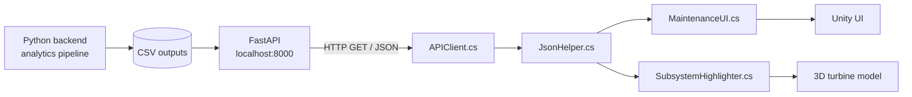

# 🎮 Offshore Wind Turbine Digital Twin — Unity 3D Client

Unity front-end for the [Wind Turbine Digital Twin](https://github.com/NeatRaptor/windmill-digital-twin). It pulls health, RUL, root-cause and maintenance data from the Python FastAPI backend and visualises it on a 3D turbine model, including colour-highlighting of affected subsystems.


> 🚧 **Work in progress.** The C# scripts are written, but the full data path (API → Unity UI → 3D model) still needs end-to-end testing in the scene.

<!-- Add a screenshot or GIF here:

-->

---

## 📑 Table of Contents
- [Overview](#-overview)
- [How It Fits Together](#-how-it-fits-together)
- [Scripts](#-scripts)
- [Getting Started](#-getting-started)
- [Scene Setup](#-scene-setup)
- [Subsystem Names](#-subsystem-names)
- [Troubleshooting](#-troubleshooting)
- [Status & Roadmap](#-status--roadmap)
- [Related Repositories](#-related-repositories)
- [License](#-license)

---

## 🔭 Overview

This repository contains the Unity project assets for the visual layer of the digital twin. It does **no analytics itself**. All numbers come from the Python backend over HTTP.

| Feature | Description |
|---|---|
| **REST client** | Generic `UnityWebRequest` GET helper |
| **JSON parsing** | Wrapper so `JsonUtility` can parse top-level JSON arrays |
| **Maintenance UI** | Renders maintenance-schedule records |
| **Subsystem highlighting** | Changes a turbine part's colour according to severity |

## 🏗️ How It Fits Together



## 📜 Scripts

Located in `Assets/Scripts/`:

| Script | Purpose |
|---|---|
| `APIClient.cs` | General-purpose HTTP GET helper built on `UnityWebRequest` |
| `JsonHelper.cs` | Wraps JSON arrays so Unity's `JsonUtility` can deserialise them |
| `MaintenanceUI.cs` | Example UI renderer for maintenance records |
| `SubsystemHighlighter.cs` | Colours a subsystem's renderer based on a severity value |

## 🚀 Getting Started

### Prerequisites
- **Unity 6.3** (install via Unity Hub)
- The Python backend running locally. Setup instructions are in [windmill-digital-twin](https://github.com/NeatRaptor/windmill-digital-twin).

### 1. Start the backend

From the backend repo root:

```powershell
uvicorn src.integration.digital_twin_api:app --reload --port 8000
```

Check that `http://127.0.0.1:8000/ping` responds before opening Unity.

### 2. Open the project

```bash
git clone https://github.com/NeatRaptor/windmill-digital-twin-unity.git
```

Unity Hub → **Add project from disk** → select the cloned folder → open with Unity 6.3.

### 3. Run the scene

Open your main scene, make sure the [scene references](#-scene-setup) are assigned, and press **Play**.

## 🧩 Scene Setup

1. Add `APIClient` to a GameObject and set the base URL to `http://127.0.0.1:8000`.
2. Add `MaintenanceUI` to a UI object and assign its text/list references in the Inspector.
3. Add `SubsystemHighlighter` to each turbine part (e.g. gearbox, generator, rotor) and assign that part's `Renderer`.
4. Make sure each part's subsystem name matches the [backend's naming](#-subsystem-names) **exactly**.

## 🏷️ Subsystem Names

The backend labels anomalies with these subsystem identifiers. Your 3D model parts need to map to them:

`GEARBOX` · `GENERATOR` · `POWER_ELECTRONICS` · `SHAFT` · `ROTOR` · `PITCH` · `YAW` · `TOWER` · `GRID` · `ENVIRONMENT` · `UNKNOWN`

> These labels come from unsupervised sensor clustering in the backend and are **provisional**. A highlighted gearbox in the scene is a model hint, not a confirmed physical diagnosis.

## 🛠️ Troubleshooting

| Problem | Likely cause / fix |
|---|---|
| Request fails immediately | Backend not running, or wrong port. Test `/ping` in a browser first |
| Fields are empty / zero after parsing | C# field names must match the JSON property names **exactly** (case-sensitive). `JsonUtility` ignores unknown keys silently |
| Array responses fail to parse | Use `JsonHelper` — `JsonUtility` cannot parse top-level arrays |
| Blocked requests in a WebGL build | The API needs CORS enabled (it is open `*` for local development) |
| `404` on `/health`, `/rul`, `/subsystem_contribution` | The backend may reference output files it doesn't generate. This is a known issue tracked in the backend repo |
| `/telemetry` values look random | By default it serves **mock** data from the telemetry generator |
| Nothing highlights | Check Inspector references and that subsystem names match |

## 🗺️ Status & Roadmap

- [x] C# templates: API client, JSON helper, maintenance UI, subsystem highlighter
- [ ] Test `/ping` from inside Unity
- [ ] Display latest RUL and health index in the HUD
- [ ] Populate the maintenance UI from `/maintenance`
- [ ] Map real 3D model parts to subsystem identifiers
- [ ] Live telemetry (polling or MQTT)
- [ ] Add screenshots / demo GIF to this README

## 🔗 Related Repositories

| Repo | Role |
|---|---|
| [windmill-digital-twin](https://github.com/NeatRaptor/windmill-digital-twin) | Python backend: ML pipeline, dashboard, FastAPI |
| **windmill-digital-twin-unity** (this repo) | Unity 3D visualisation client |

## 📄 License

Add a license (e.g. MIT). If you use third-party 3D models or assets, list their licences and attribution here.
